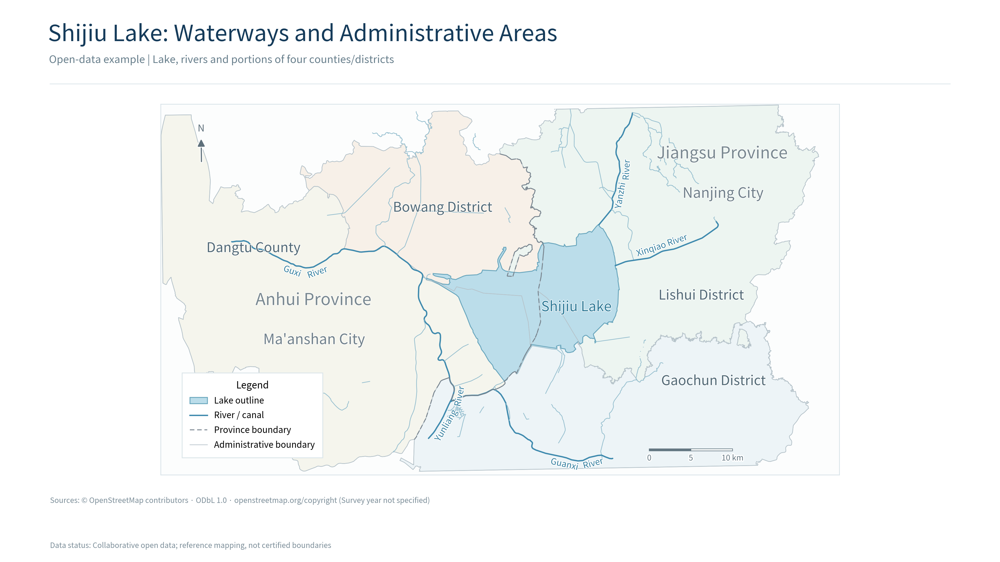

# River Lake Cartography

A portable desktop workbench for presentation maps of rivers, lakes and surrounding administrative areas. It combines a local browser interface, a Python cartographic renderer and reproducible project folders. The Windows download includes its own Python runtime, dependencies and font.

**Preview release: `1.0.0-preview.1`.** Start with the offline Shijiu Lake example. The application can also import local GeoJSON or retrieve bounded-area OpenStreetMap data. Automatic layout can fail on difficult river geometry; the program preserves a diagnostic preview and reports the affected labels.

[Download Windows builds](https://github.com/weipoithena-cpu/river-lake-cartography/releases) · [Development process](docs/DEVELOPMENT.md) · [Validation record](VALIDATION.md) · [Contribute](CONTRIBUTING.md) · [First-time publishing guide](docs/PUBLISHING.md)

The example above is an actual render of the included data, with English labels. It is a reference map based on collaborative open data, not an officially certified administrative-boundary product.

## Get started on Windows

1. Download the Windows x64 ZIP from **Releases** and extract the **entire archive** into a writable folder, such as `D:\RiverLakeCartography`.
2. Open `RiverLakeCartography.exe`. Your default browser opens the local application.
3. Run the built-in example and inspect the generated map and quality report.
4. Download PNG, SVG or the complete project ZIP.
5. Use the application's exit button when finished. Closing the browser tab alone does not stop the local service.

Target systems are Windows 10/11 x64. Recipients do not need Python, Codex or GIS software. Keep the EXE, `app` and `runtime` folders together. **Share the complete ZIP, not the EXE alone.**

The application processes imported files locally and binds its web service to `127.0.0.1`. Online place search and data retrieval contact the selected public services. No large-language-model account or inference service is embedded.

## Three ways to create a map

| Entry | Input | What happens |
|---|---|---|
| Offline example | Bundled Shijiu Lake snapshot | Produces a local map from authentic, documented open data |
| Import | Lake polygons, river lines and/or administrative polygons in GeoJSON | Checks the declared coordinate system, prepares a project and renders it |
| Online search | A place name and confirmed local extent | Uses Photon for search and Overpass/OpenStreetMap for spatial data |

Supported geometry types are `Polygon`/`MultiPolygon` for lakes and administrative areas, and `LineString`/`MultiLineString` for rivers. Import at least one layer and confirm **EPSG:4326, longitude first, latitude second**. Numeric range checks cannot identify an undeclared GCJ-02 or BD-09 offset.

A supplied `map_job.json` can control the extent, labels and output. Select its referenced layer files together with the configuration. The application does not read arbitrary local files named in imported configuration paths.

Online queries are limited to local areas: each geographic span is at most 3 degrees, each side approximately 220 km, and the approximate area 30,000 km². Public services can time out, rate-limit requests or return incomplete data. Technical users can configure authorized HTTPS alternatives with `RIVERLAKE_PHOTON_URL` and `RIVERLAKE_OVERPASS_URL`.

## Cartographic rules built into the workflow

- Place river names along the actual river path. River-name leader lines are prohibited.
- Keep the legend inside the lower-left corner of the main map frame.
- Apply consistent province/city/county label hierarchy. The complete administrative label footprint must remain within the corresponding visible jurisdiction.
- Preserve real geography. Resolve layout conflicts through label placement, readable type size or extent changes; do not move rivers, shorelines or boundaries.
- Report required labels that cannot be placed. Do not silently remove them or label a diagnostic image as a completed map.

The first three items are this project's adopted requirements. They are **not a claim that every national map standard mandates this exact project style**. Technical references and the distinction between project rules, standards and applicable legal requirements are documented in [Cartographic rules](app/core/references/cartographic-rules.md).

## Outputs and project history

The workbench saves each task in a separate folder under its output directory and displays the actual path in the results area. On Windows the default location is beneath the user's Documents folder.

| Output | Intended use |
|---|---|
| PNG | Insert directly into PowerPoint or a report |
| SVG | Scale the vector map; text is outlined for consistent display and is not native editable text |
| `map_job.json` | Reproduce or adjust the map configuration |
| Source records and `qa.json` | Inspect source limitations, projected coordinate system, labels and measured layout checks |
| Project ZIP | Move the configuration, data and results together |

Re-rendering creates a new version and preserves earlier versions. The Codex handoff button copies a project-specific prompt for further data checks or layout work in a separate local Codex session.

## Example data and English labels

The offline example contains Shijiu Lake, portions of four county/district areas and 153 river/channel features. Its requested labels comprise five rivers, eight administrative names and one lake name. Geometry coordinates and OSM object IDs are preserved from the source snapshot. The English edition translates names and descriptive attributes; the data registry records original and translated-file hashes.

Proper names use pinyin with English feature-type words. These working labels are not asserted to be certified official English names. The dataset is an ODbL derivative with attribution to OpenStreetMap contributors. It is not an authoritative cadastral boundary dataset, a surveyed water surface at a specified level, or a verified complete inflow/outflow network. See [example sources](app/examples/shijiu/sources.json) and [data license](app/examples/shijiu/DATA_LICENSE.md).

## Validation and present limits

The English edition passed **34 regression checks**: 10 data tests, 7 typography tests, 5 real HTTP/render integration tests and 12 simulated frontend DOM tests. Its actual Linux self-test produced the English Shijiu Lake map with all 14 requested labels and no automatic errors. See the [self-test record](validation/english-linux-self-test.json), [map quality record](validation/english-example-qa.json) and [VALIDATION.md](VALIDATION.md). **Linux execution does not establish native Windows acceptance, and mocked DOM tests do not establish real-browser visual acceptance.** Consult the specific release's results for native-platform evidence.

A live Xuanwu Lake experiment retrieved real data but left three automatically suggested river labels unplaced. That result remains a diagnostic example, not an approved map. Survey dates, data authority and final presentation readability require task-specific review; the renderer does not issue a map approval number.

This version does not implement DEM drainage extraction, dated satellite-water segmentation, screenshot georeferencing, monitoring-site positioning, hydrodynamic analysis, nationwide cartography or direct Shapefile/GeoPackage/CAD/Excel import. Convert suitable spatial inputs to GeoJSON before importing them. See the [roadmap](docs/ROADMAP.md).

## Develop and rebuild

The runtime application is in `app`; the native Windows launcher and portable assembler are in `build_tools`. A fresh Git clone retrieves the hash-pinned Noto font with `python build_tools/fetch_font.py`; portable packages include the font. See [CONTRIBUTING.md](CONTRIBUTING.md) for setup and tests, and [Architecture](docs/ARCHITECTURE.md) for the data flow.

On Windows, `build_tools\build_windows.cmd` assembles the pinned Windows runtime, starts the actual EXE in self-test mode, and creates the portable ZIP after its checks pass. Build dependencies are separate from ordinary end-user operation. The native acceptance instructions are in [WINDOWS_ACCEPTANCE_PROMPT.txt](WINDOWS_ACCEPTANCE_PROMPT.txt).

## License

Application code is released under the [MIT License](LICENSE). Bundled libraries and the Noto font retain their own licenses. Example OSM-derived data is provided under ODbL 1.0, with contributor attribution and source links. Government references are linked as external sources; original Chinese government PDFs are not bundled in this English edition.
